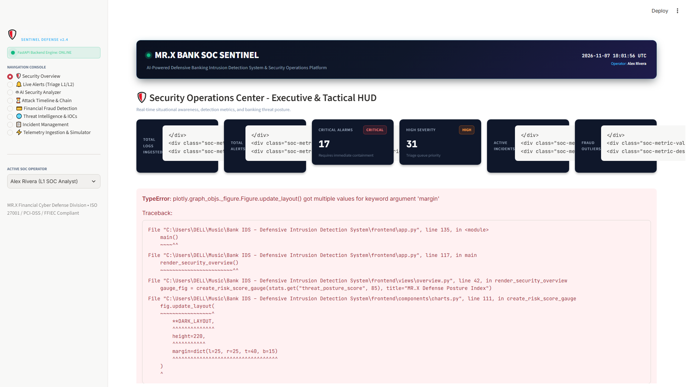
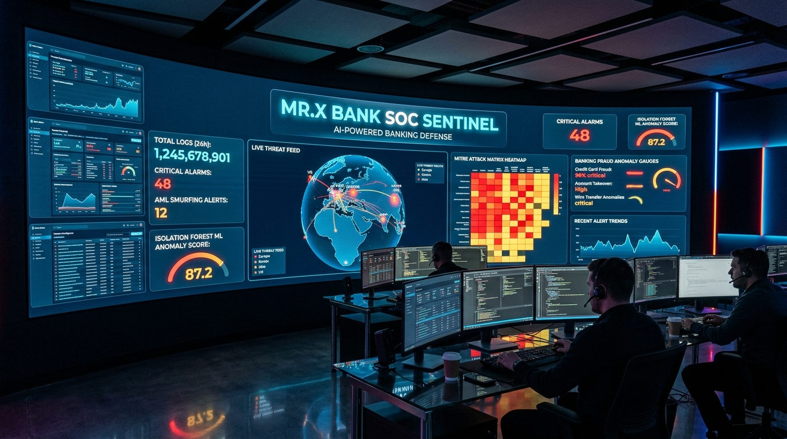

# MR.X BANK SOC SENTINEL

### Enterprise AI-Powered Banking Security Operations Center (SOC) & Defensive Intrusion Detection System

[](https://www.python.org/)
[](https://fastapi.tiangolo.com/)
[](https://streamlit.io/)
[](https://scikit-learn.org/)
[](https://attack.mitre.org/)
[](#compliance)

---

## 📸 SOC Dashboard & Command Center Preview





---

## 🏛️ Executive Overview

**MR.X BANK SOC SENTINEL** is an AI-powered Security Operations Center (SOC) and defensive intrusion detection platform engineered specifically for **Tier-1 / Tier-2 SOC Analysts, Threat Hunters, and Fraud Operations Specialists** within banking and financial institutions.

The platform bridges the critical gap between traditional network/web telemetry and core banking financial transactions, providing unified defense against cyber espionage, financial fraud, credential attacks, and money laundering.

```
                               ┌─────────────────────────────────────────────────────────────┐
                               │                    MR.X BANK SOC SENTINEL                   │
                               └──────────────────────────────┬──────────────────────────────┘
                                                              │
         ┌─────────────────────────────────┬──────────────────┴────────────────┬────────────────────────────────┐
         │                                 │                                   │                                │
┌────────▼────────┐               ┌────────▼────────┐                 ┌────────▼────────┐              ┌────────▼────────┐
│ Log Collection  │               │Detection Engine │                 │AI Security      │              │Threat Intel &   │
│ & Normalization │               │ 12 Bank Rules   │                 │Analyzer         │              │MITRE ATT&CK     │
├─────────────────┤               ├─────────────────┤                 ├─────────────────┤              ├─────────────────┤
│• Auth Log Stream│               │• Brute Force    │                 │• Explainable AI │              │• IP Reputation  │
│• Web Access Logs│──────────────>│• Cred Stuffing  │────────────────>│• Dynamic Risk   │─────────────>│• IOC Tracking   │
│• Bank Tx Streams│               │• ATO & Traversal│                 │• Attack Context │              │• ATT&CK Matrix  │
│• JSON/JSONL Norm│               │• Smurfing (AML) │                 │• Playbook Steps │              │• Geolocation    │
│• GeoIP Telemetry│               │• ML Outliers    │                 │• Decision Supp  │              │• ASN Attribution│
└─────────────────┘               └─────────────────┘                 └─────────────────┘              └─────────────────┘
                                           │                                   │
                                           └──────────────────┬────────────────┘
                                                              │
                                            ┌─────────────────▼─────────────────┐
                                            │ Streamlit SOC Analyst HUD (L1/L2) │
                                            ├───────────────────────────────────┤
                                            │• Executive Overview & Live Pulse  │
                                            │• Real-Time Alert Triage Console   │
                                            │• Cyber Attack Timeline & Chains   │
                                            │• Financial Fraud & AML Center     │
                                            │• Full Incident Case Lifecycle     │
                                            │• Live Attack Scenario Simulator   │
                                            └───────────────────────────────────┘
```

---

## 🚀 Key Modules & Architecture

### 1. Log Collection & Normalization Engine

- **Multi-Vector Telemetry:** Concurrently parses and standardizes:
  - **Authentication Logs:** Customer portal and core ledger administrative logins (`login_failed`, `login_success`, MFA challenges).
  - **Web Server Telemetry:** HTTP methods, endpoints, status codes, query strings, and payloads.
  - **Financial Transactions:** Transaction amounts, currencies, source/destination accounts, and wire transfer types (`swift_mt103`, `ach`, `p2p_transfer`).
- **Flexible Ingestion:** Ingests single JSON payloads, batch arrays, or streaming multi-line JSONL log files.
- **Timestamp Standardization:** Converts varied ISO 8601, RFC 3339, and epoch formats into standardized UTC datetimes.
- **Geo-Telemetry Enrichment:** Enriches events with IP geolocation, ASN, and hosting provider metadata.

### 2. Banking Detection Engine (12 Rules)

The platform features 12 production-grade detection rules categorized across the cyber threat landscape:

| Rule ID         | Rule Name                                      | Category        | Severity        | MITRE ATT&CK                              |
| --------------- | ---------------------------------------------- | --------------- | --------------- | ----------------------------------------- |
| `RULE-AUTH-001` | Brute Force Password Guessing                  | Authentication  | HIGH            | **T1110.001** (Password Guessing)         |
| `RULE-AUTH-002` | Distributed Credential Stuffing Wave           | Authentication  | CRITICAL        | **T1110.004** (Credential Stuffing)       |
| `RULE-AUTH-003` | Account Takeover (ATO) Pattern                 | Authentication  | CRITICAL        | **T1078.003** (Valid Accounts)            |
| `RULE-AUTH-004` | Impossible Travel Anomaly (>850 km/h)          | Authentication  | HIGH            | **T1078** (Geographically Disjointed)     |
| `RULE-AUTH-005` | Suspicious Off-Hours Admin Login               | Authentication  | HIGH / CRITICAL | **T1078.002** (Domain Accounts)           |
| `RULE-WEB-001`  | SQL Injection (SQLi) Attempt                   | Web Application | CRITICAL        | **T1190** (Exploit Public-Facing App)     |
| `RULE-WEB-002`  | Cross-Site Scripting (XSS) Injection           | Web Application | HIGH            | **T1059.007** (JavaScript Execution)      |
| `RULE-WEB-003`  | Path Traversal / Local File Inclusion (LFI)    | Web Application | HIGH            | **T1190** (File Discovery/Exploitation)   |
| `RULE-WEB-004`  | OS Command Injection Attempt                   | Web Application | CRITICAL        | **T1059.004** (Command Interpreter)       |
| `RULE-FRD-001`  | High-Value Wire Threshold Exceeded (>$50,000)  | Financial Fraud | HIGH / CRITICAL | **T1499** (Financial Exfiltration)        |
| `RULE-FRD-002`  | Transaction Velocity Spike (>=4 in <=3 min)    | Financial Fraud | HIGH            | **T1565.001** (Data Manipulation)         |
| `RULE-FRD-003`  | AML Transaction Structuring (Smurfing)         | Financial Fraud | CRITICAL        | **T1562** (Evade Mandatory CTR Reporting) |
| `RULE-FRD-004`  | Machine Learning Transaction Anomaly (IForest) | Financial Fraud | MEDIUM / HIGH   | **T1098** (Account Manipulation)          |

### 3. AI Security Analyzer (Analyst Decision Support)

- **Explainable Threat Reasoning:** Demystifies opaque rule alerts into plain-English root causes detailing which payload fired, what threshold tripped, and what baseline was breached.
- **Dynamic Evidence-Based Risk Scoring (0–100):** Considers base severity, financial ledger impact, threat actor attribution, and past offender history.
- **Multi-Vector Context Correlation:** Automatically correlates web injection probes with subsequent credential dumps and financial withdrawals.
- **Defensive Playbook Generation:** Actionable containment steps tailored to the attack category (Firewall BGP block, JWT token revocation, SWIFT ledger administrative hold, FinCEN SAR filing).
- **Human-in-the-Loop Philosophy:** Designed strictly to empower SOC Analysts (L1/L2), providing evidence-backed recommendations rather than black-box auto-confirmations.

### 4. Threat Intelligence & MITRE ATT&CK

- **Curated Financial Threat Feeds:** Pre-seeded with known Tor exit nodes, Carbanak / FIN7 banking C2s, Lazarus Group infrastructure, and commercial proxy ranges.
- **Multi-Factor IP Reputation Engine:** Computes risk based on direct IOC hits, autonomous system classification, and geographic risk score.
- **MITRE ATT&CK Matrix Mapping:** Complete taxonomy aligning every detection rule with Tactics, Techniques, and Mitigation guidelines.

### 5. Security Incident Management Lifecycle

- **Incident State Machine:** `OPEN` ➔ `UNDER_INVESTIGATION` ➔ `CONTAINED` ➔ `RESOLVED` / `CLOSED_FALSE_POSITIVE`.
- **Escalation Workflows:** Seamless handoff from `L1_TRIAGE` to `L2_INVESTIGATION` to `L3_FORENSICS_LEAD`.
- **Chronological Audit Trail:** Granular timestamped timeline logging all status transitions, containment executions, and alert associations.
- **Analyst Investigation Notes:** Rich journaling for forensic findings and shift handovers.

### 6. Interactive SOC Streamlit Dashboard

- **Security Overview (HUD):** Posture gauge, severity distribution donut, attack category bar chart, and active alarms ticker.
- **Live Alerts Console:** Filterable alert feed with deep-dive drawer, evidence inspector, and one-click incident promotion.
- **AI Security Analyzer Console:** On-demand AI inspection for any existing alert or raw custom payload.
- **Attack Timeline & Correlation:** Visual multi-stage kill chains and chronological security audit events.
- **Financial Fraud Center:** AML smurfing monitor, velocity burst tracker, and Scikit-learn Isolation Forest scatter plot.
- **Threat Intelligence & IOCs:** Interactive IP reputation tester, IOC database editor, and MITRE coverage heatmap.
- **Incident Management Desk:** Kanban status queue, case journals, and defensive containment controls.
- **Telemetry Ingestion & Simulator:** Ingest custom JSON/JSONL files or trigger 1-click synthetic attacks.

---

## 📦 Installation & Setup

### Prerequisites

- Python 3.11+
- Git

### 1. Clone Repository & Install Dependencies

```bash
git clone <repository_url>
cd "Bank IDS – Defensive Intrusion Detection System"
pip install -r requirements.txt
```

### 2. Launch the Platform

Run both the FastAPI backend and Streamlit SOC Dashboard simultaneously:

```bash
python run_all.py
```

Or launch services independently in separate terminals:

**Terminal 1: FastAPI Backend (Port 8000)**

```bash
python -m uvicorn main:app --host 127.0.0.1 --port 8000 --reload
```

**Terminal 2: Streamlit Dashboard (Port 8501)**

```bash
python -m streamlit run frontend/app.py --server.port 8501
```

Access Points:

- **Streamlit SOC Dashboard:** [http://localhost:8501](http://localhost:8501)
- **FastAPI Interactive API Docs:** [http://127.0.0.1:8000/docs](http://127.0.0.1:8000/docs)
- **FastAPI Health Endpoint:** [http://127.0.0.1:8000/api/health](http://127.0.0.1:8000/api/health)

---

## 🧪 Running Automated Tests

Run the complete test suite verifying log normalization, rules, machine learning, AI analyzer, and incident management:

```bash
python -m pytest tests/test_sentinel.py -v
```

---

## 🎯 Simulated Attack Scenarios

Inside the **⚡ Telemetry Ingestion & Simulator** section of the dashboard, you can trigger realistic banking cyberattack scenarios with a single click:

1. **Brute Force Wave:** 7 failed logins against a single user account from a Tor Exit node.
2. **Credential Stuffing:** Automated spraying targeting 6 distinct bank customer accounts.
3. **Account Takeover (ATO):** Failed brute-force wave followed by successful authentication.
4. **Impossible Travel:** Sequential logins from New York and Frankfurt within 17 minutes (>2,500 km/h).
5. **Suspicious Admin Login:** Privileged access to `/swift-gateway` at 03:15 AM from an untrusted public IP.
6. **SQL Injection (SQLi):** `UNION SELECT` probing against customer account balance APIs.
7. **Web Exploit Chain:** Combined XSS session cookie stealer, LFI path traversal (`/etc/passwd`), and OS command injection.
8. **AML Structuring (Smurfing):** 4 transfers of $9,400 to $9,850 deliberately structured below the $10,000 BSA threshold.
9. **Transaction Velocity Spike:** 5 automated wire transfers within 90 seconds.
10. **Large Wire Transfer Fraud:** Single $250,000 unauthorized wire transfer.
11. **Seed Full Demo Environment:** 1-click button that populates all threat intelligence feeds, multi-vector attack scenarios, and open security incidents.

---

## ⚖️ Regulatory Compliance & Banking Standards

- **Bank Secrecy Act (BSA) 31 U.S.C. 5324:** Detection of structured transactions avoiding Currency Transaction Reporting (CTR) with automated FinCEN Form 111 SAR filing guidance.
- **PCI-DSS v4.0 Requirement 10 & 11:** Continuous log normalization, automated intrusion detection, and centralized audit trails.
- **FFIEC Information Security Guidelines:** Dual-custody oversight, privileged access monitoring, and out-of-band transaction verification.
- **MITRE ATT&CK for Financial Services:** Full tactic and technique mapping for audit transparency.

---

## 👥 SOC Roles & Responsibilities

- **Alex Rivera (L1 SOC Analyst):** Initial alert triage, false positive elimination, perimeter IP blocking, and incident creation.
- **Elena Rostova (L2 Senior Incident Responder):** Deep forensic payload analysis, session revocation, and SWIFT ledger hold coordination.
- **Marcus Chen (SOC Lead & Threat Hunter):** Campaign correlation, APT threat actor attribution, and proactive threat hunting.

---

_MR.X BANK SOC SENTINEL • Developed for High-Assurance Financial Cyber Defense._

Author

George Botrs Azer Junior SOC Analyst | SIEM, Log Analysis, Threat Detection
